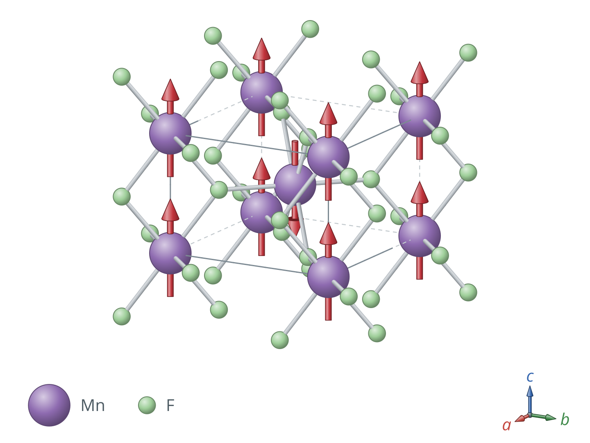
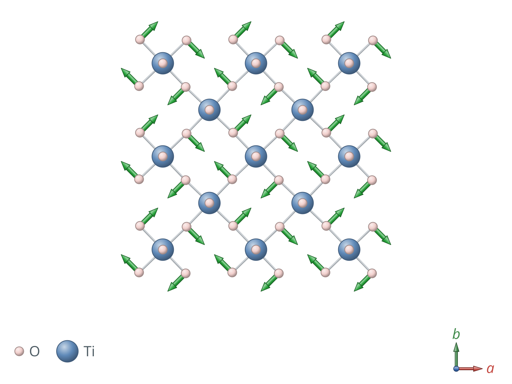
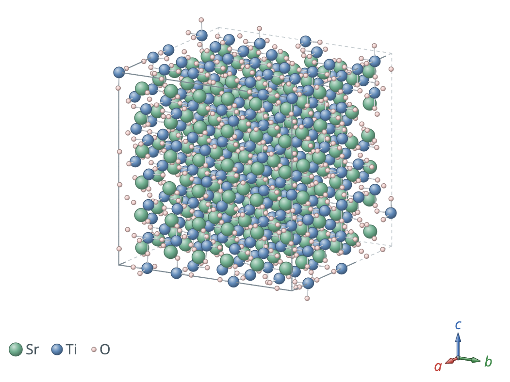
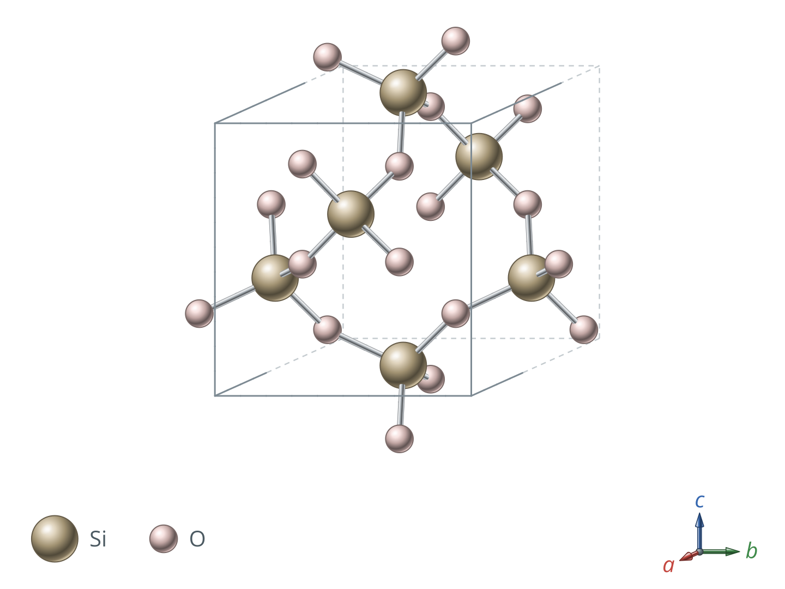
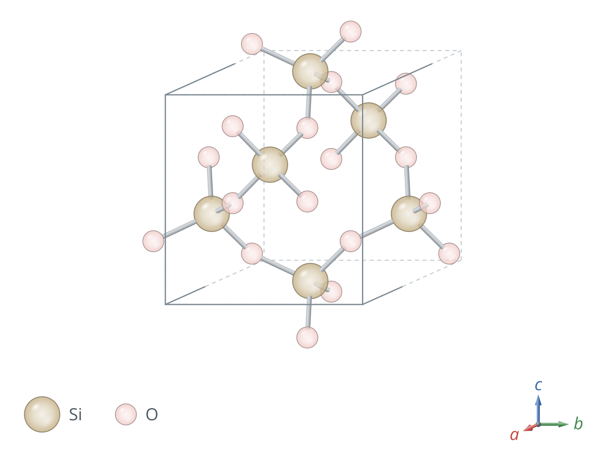
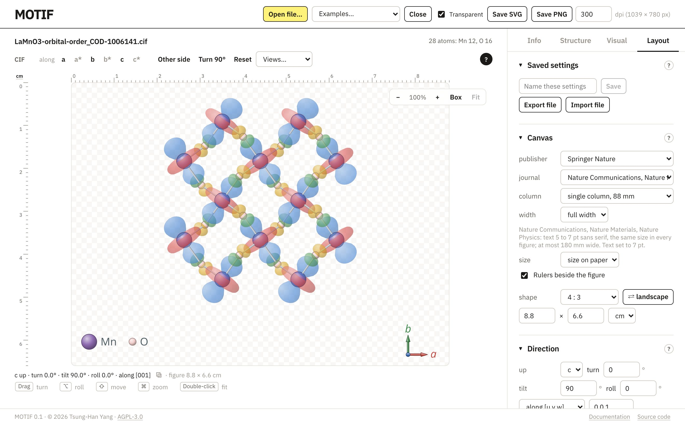

# MOTIF

**Publication-quality crystal structure figures, in the browser.** MOTIF turns a structure file into a clean
figure for a paper or a slide, ready to place in your figure layout. Nothing to install.

- **Vector, ready to edit.** Save an SVG and open it in Adobe Illustrator, Inkscape or Keynote: every atom, bond
  and arrow is its own shape and every label is live text, so you can recolour, move and combine panels into the
  full figure of a paper yourself. A PNG at any dpi is drawn from the same SVG.
- **Text at the journal's size.** Legend names, axis letters and angle labels are set in pt (7 pt by default) and
  stay exactly that size whatever you zoom and however large the structure.
- **Sized for the journal.** Pick the publisher, journal and column, and the figure takes the width that journal
  prints and its text size. The SVG states its size on paper, so it opens at that size, and every panel you make
  has the same lettering, with no rescaling by hand.

**▶ [Open MOTIF](https://drthyang.github.io/motif/)**: your file is read on your own machine and never uploaded.

  

*MOTIF with the coordination-polyhedra example open: the tilted MnO₆ octahedra of one LaMnO₃ layer, the figure
sized on paper (rulers in cm), and the bond rule that draws the polyhedra in the side panel. Every figure on this
page is MOTIF's own output.*

In crystallography the *motif* is the group of atoms repeated at every lattice point.

## Examples

<table>
  <tr>
    <td width="50%" align="center" valign="top"> <b>Orbital order</b>: LaMnO₃, Mn eg and O 2p orbitals, coloured by the sign of the lobe</td>
    <td width="50%" align="center" valign="top"> <b>Magnetic structure</b>: MnF₂, moments along ±c from the magnetic CIF</td>
  </tr>
  <tr>
    <td width="50%" align="center" valign="top"> <b>Distortion mode</b>: SrTiO₃, the octahedra turned about <i>c</i> (ISODISTORT)</td>
    <td width="50%" align="center" valign="top"> <b>RMC configuration</b>: a 6 × 6 × 6 SrTiO₃ supercell; <b>Fold</b> averages it to one cell</td>
  </tr>
  <tr>
    <td width="50%" align="center" valign="top"> <b>Metal surface</b>: quartz, metallic atoms and bonds</td>
    <td width="50%" align="center" valign="top"> <b>Glass surface</b>: quartz, bonds seen through atoms</td>
  </tr>
</table>

Figures © 2026 Tsung-Han Yang, made with MOTIF from public structures (COD) or files written for MOTIF.

## Sized for the journal

Choose the publisher, the journal and the column, and MOTIF sets the figure to the width that journal prints,
keeping its shape, and the text to the journal's size in pt. A figure can also take 1/2, 1/3 or 1/4 of the
column, for one panel in a row. Rulers beside the figure show its size in cm or in.

  

Templates, each from the publisher's own author pages: Nature; Nature Communications, Nature Materials and
Nature Physics; Science; Physical Review; ACS journals; RSC journals; Elsevier journals; J. Phys.: Condens.
Matter; the IUCr journals; American Mineralogist. The SVG states its size on paper, so it opens at exactly that
size in Illustrator, Inkscape or Keynote; the PNG is drawn from the same SVG.

## What it does

- **Reads the files you have:** CIF; magnetic CIF, with moments carried by the magnetic group and time
  reversal; ISODISTORT CIFs, with distortion modes drawn as displacement arrows; RMCProfile `.rmc6f`
  configurations, as the whole supercell or folded into one averaged cell; VASP POSCAR and CONTCAR; XYZ and
  extended XYZ; SHELX `.res` and `.ins`, with their symmetry; PDB; Quantum ESPRESSO input; CASTEP `.cell`;
  FHI-aims `geometry.in`; XSF. The format is shown over the figure.
- **Vector or raster:** an SVG you can edit, with live text at a fixed size in pt, or a PNG at any dpi,
  transparent or on white.
- **Shows the chemistry:** cells or a slab, bonds by distance, coordination polyhedra (glass, solid or line art),
  bond angles, chains and filled polygons, shared sites as pie spheres, and s, p, d and f orbitals as schematic isosurfaces.
- **Styled your way:** soft, flat, glossy, metal or glass surfaces; bonds in atom colours, dashed or dotted;
  axis arrows in their own colours; preset views (clinographic, isometric) or a view along any [uvw] or normal
  to any (hkl); your settings saved and reused.
- **An assistant that knows the knobs:** in the drawer under the side panel, say "make the O atoms red" or "size it
  for Physical Review, half a column", and it changes the controls and tells you where each one is. Claude, OpenAI
  or Gemini with your own API key, or a local model (Ollama, LM Studio) on which nothing leaves your computer.
  It can also add magnetic moments you state (size and direction for an element, nothing assumed by symmetry) and
  save the structure as CIF, VASP POSCAR, XYZ or extended XYZ (every atom of one cell). An API key is kept only
  in your browser; with a key, the structure is sent to that company, and with a local model nothing leaves your
  computer.
- **From MATERIA:** MATERIA's "Open in MOTIF" sends its refined structure straight to a MOTIF tab, browser to
  browser; nothing is uploaded.
- **Works with a mouse, a trackpad or fingers:** drag to turn, pinch to zoom, two fingers to move and twist.
- **Checked, not just drawn:** symmetry expansion against gemmi, moment directions against pymatgen,
  displacements against published coordinates, orbitals for orthogonality, and every file format against the
  CIF reading of the same crystal, each in the test suite.

## Quick start

Open [the app](https://drthyang.github.io/motif/) and drop a file on it, or start from one of the feature
examples on the start page: coordination polyhedra (the tilted MnO₆ octahedra of LaMnO₃), a magnetic structure (MnF₂), a distortion mode (the
TiO₆ octahedra of SrTiO₃ turned about *c*), orbital order (the Mn eg and O 2p orbitals of LaMnO₃) and an RMC
configuration (its supercell; **Fold** averages it to one cell). Turn the structure with the mouse,
then press **Save SVG** or **Save PNG**.

## Status

Beta. Every planned step is done ([conventions and status](docs/CONVENTIONS.md#steps-of-the-first-version)).

## Documentation

- [docs/CONVENTIONS.md](docs/CONVENTIONS.md): every convention, what each choice was and when it was made, how
  each part is checked, and how to build and test.
- [examples/README.md](examples/README.md): the example structures and their sources.

## Licence

Copyright (C) 2026 Tsung-Han Yang. MOTIF is free software under the GNU Affero General Public License,
version 3 or later ([LICENSE](LICENSE)). The licence covers the program, not the figures you make with it.

Parts of the CIF reader, the symmetry code and the element data are adapted from [MATERIA](https://github.com/drthyang/materia-platform),
and the RMCProfile reader from [RMCProfile Workbench](https://github.com/drthyang/rmc-toolkits), both by the same
author; those files say so in their header. The page's font, IBM Plex Sans, is under the SIL Open Font License
1.1; it and the third-party code the page contains (React, the Anthropic SDK and their dependencies, all MIT or
similar) are listed with their licences in [public/third-party-licenses.txt](public/third-party-licenses.txt),
linked as **Licences** at the foot of the page.

Data and methods used, with thanks:
- Example structures marked COD are from the Crystallography Open Database (public domain; S. Gražulis et al.,
  *J. Appl. Cryst.* **42**, 726 (2009)); each file keeps its original reference.
- The distortion-mode examples were decomposed with ISODISTORT (H. T. Stokes, D. M. Hatch and B. J. Campbell,
  ISOTROPY Software Suite, iso.byu.edu; B. J. Campbell, H. T. Stokes, D. E. Tanner and D. M. Hatch, *J. Appl.
  Cryst.* **39**, 607 (2006)); its output is kept with its header.
- The default atom sizes follow the covalent radii of B. Cordero et al., *Dalton Trans.* 2832 (2008).

Journal, publisher and software names (Nature, Science, Physical Review, Adobe Illustrator, Keynote and others)
are used only to say what MOTIF works with; MOTIF is not affiliated with or endorsed by any of them.
