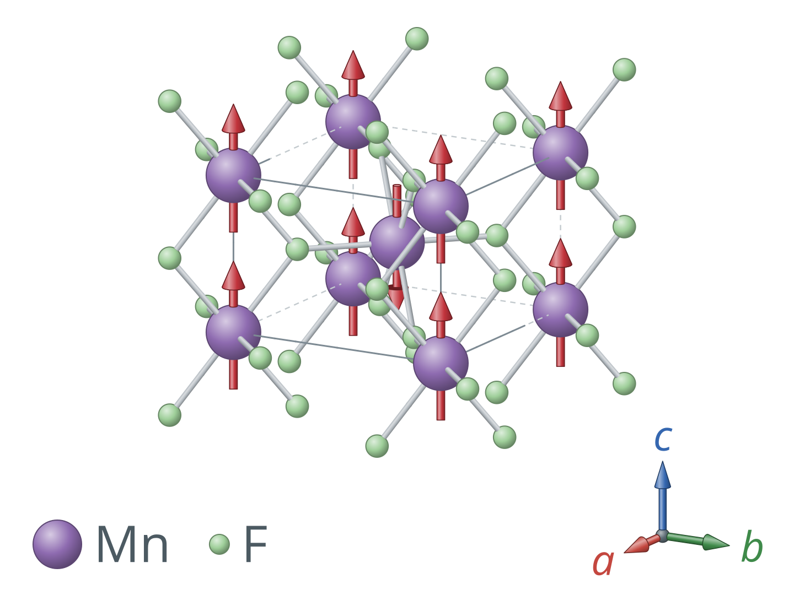

# MOTIF

**Crystal structure figures, drawn in the browser.** Clean vector figures from CIF, magnetic CIF, ISODISTORT
and RMCProfile files, ready for a paper or a slide, with nothing to install.

**▶ [Open MOTIF](https://drthyang.github.io/motif/)**: your file is read on your own machine and never uploaded.
*The app is not online yet; this link will work once it is published.*

  

*The antiferromagnet MnF₂ as MOTIF draws it: moments along ±c, Mn–F bonds, the unit cell. This image is
MOTIF's own SVG output.*

In crystallography the *motif* is the group of atoms repeated at every lattice point.

## What it does

- **Reads the files you have:** CIF; magnetic CIF, with moments carried by the magnetic group and time
  reversal; ISODISTORT CIFs, with distortion modes drawn as displacement arrows; RMCProfile `.rmc6f`
  configurations, as the whole supercell or folded into one averaged cell.
- **Figures sized for a journal:** the size on paper (a Nature single column, 89 mm, 4:3, by default), with
  templates for Nature, Science, Physical Review, ACS, RSC, Elsevier, the IUCr journals and other journals that
  print crystal structures; text in pt; an SVG that opens at exactly that size in Illustrator or Keynote, and a PNG at the dpi you choose,
  drawn from the same SVG.
- **Shows the chemistry:** cells or a slab, bonds by distance, bond angles, chains and filled polygons, shared
  sites as pie spheres, and s, p, d and f orbitals as schematic isosurfaces.
- **Styled your way:** soft, flat, glossy, metal or glass surfaces; bonds in atom colours, dashed or dotted;
  preset views (clinographic, isometric) or a view along any [uvw] or normal to any (hkl); your settings
  saved and reused.
- **Checked, not just drawn:** symmetry expansion against gemmi, moment directions against pymatgen,
  displacements against published coordinates, orbitals for orthogonality, each in the test suite.

## Quick start

Open [the app](https://drthyang.github.io/motif/) and drop a file on it, or start from one of the feature
examples on the start page: an atomic structure (quartz), a magnetic structure (MnF₂), a distortion mode (the
TiO₆ octahedra of SrTiO₃ turned about *c*), orbital order (the Mn e_g and O 2p orbitals of LaMnO₃) and an RMC
configuration folded into one cell. Turn the structure with the mouse,
then press **Save SVG** or **Save PNG**.

## Status

Beta. Every planned step is done ([conventions and status](docs/CONVENTIONS.md#steps-of-the-first-version)).

## Documentation

- [docs/CONVENTIONS.md](docs/CONVENTIONS.md): every convention, what each choice was and when it was made, how
  each part is checked, and how to build and test.
- [examples/README.md](examples/README.md): the example structures and their sources.

## Licence

Copyright (C) 2026 Tsung-Han Yang. MOTIF is free software under the GNU Affero General Public License,
version 3 or later ([LICENSE](LICENSE)). The licence covers the program, not the figures you make with it.

Parts of the CIF reader, the symmetry code and the element data are adapted from [MATERIA](https://github.com/drthyang/materia-platform),
and the RMCProfile reader from [RMCProfile Workbench](https://github.com/drthyang/rmc-toolkits), both by the same
author; those files say so in their header. The page's font, IBM Plex Sans, is under the SIL Open Font License
1.1. Example structures marked COD are from the Crystallography Open Database (public domain).
