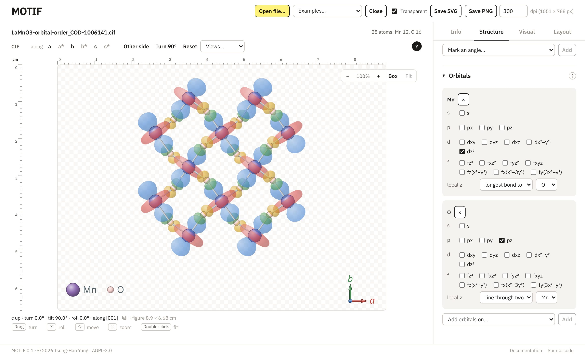
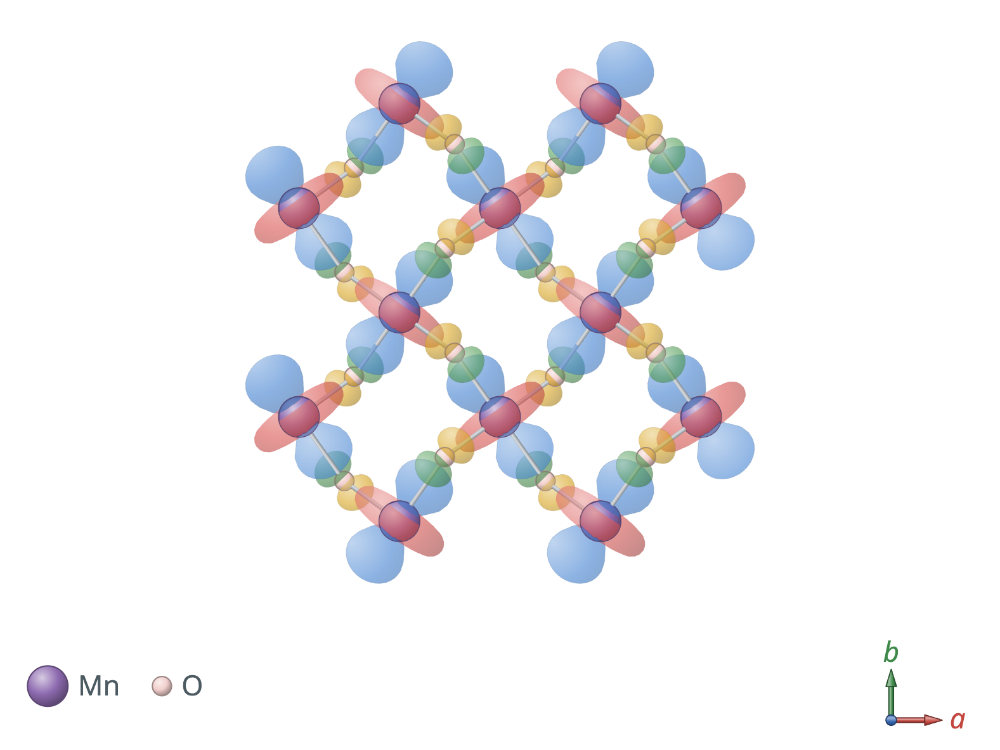
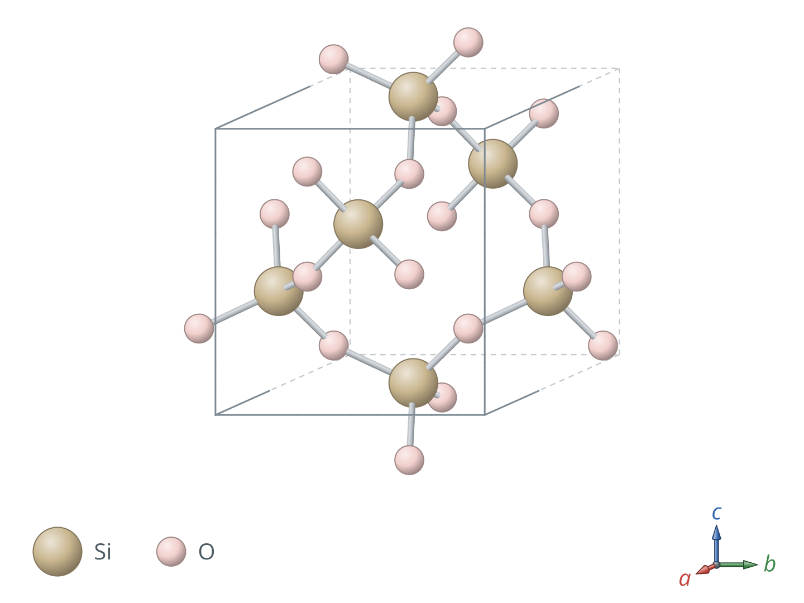

# MOTIF

**Publication-quality crystal structure figures, in the browser.** MOTIF turns a structure file into a clean
figure for a paper or a slide: vector (SVG) or raster (PNG at the dpi you choose), sized for the journal you are
submitting to. Nothing to install.

**▶ [Open MOTIF](https://drthyang.github.io/motif/)**: your file is read on your own machine and never uploaded.
*The app is not online yet; this link will work once it is published.*

  

*MOTIF with the orbital-order example open: the figure on its canvas, sized on paper (rulers in cm), and the
orbitals chosen for Mn and O in the side panel. Every figure on this page is MOTIF's own output.*

In crystallography the *motif* is the group of atoms repeated at every lattice point.

## Examples

<table>
  <tr>
    <td colspan="2" align="center"> <b>Orbital order</b>: LaMnO₃, the Mn eg orbital of each site along its long Mn–O bond and the O 2p orbitals along each Mn–O–Mn line, coloured by the sign of the lobe</td>
  </tr>
  <tr>
    <td width="50%" align="center"> <b>Atomic structure</b>: quartz, with its Si–O bonds</td>
    <td width="50%" align="center"> <b>Magnetic structure</b>: MnF₂, moments along ±c from the magnetic CIF</td>
  </tr>
  <tr>
    <td width="50%" align="center"> <b>Distortion mode</b>: SrTiO₃, the octahedra turned about <i>c</i> (ISODISTORT)</td>
    <td width="50%" align="center"> <b>RMC configuration</b>: a 6 × 6 × 6 SrTiO₃ supercell; <b>Fold</b> averages it to one cell</td>
  </tr>
</table>

Figures © 2026 Tsung-Han Yang, made with MOTIF from public structures (COD) or files written for MOTIF.

## Sized for the journal

Choose the publisher, the journal and the column, and MOTIF sets the figure to the width that journal prints,
keeping its shape, and the text to the journal's size in pt. A figure can also take 1/2, 1/3 or 1/4 of the
column, for one panel in a row. Rulers beside the figure show its size in cm or in.

  

**Text stays the size you set.** Legend names, axis letters and angle labels are given in pt (7 pt by default)
and are exactly that size in the saved figure, whatever you zoom, however large the structure, and whichever
width you choose. Placed at its size on paper, every panel of a paper's figures has the same lettering, matching
the journal's rules, with no rescaling by hand in a drawing program.

Templates, each from the publisher's own author pages: Nature; Nature Communications, Nature Materials and
Nature Physics; Science; Physical Review; ACS journals; RSC journals; Elsevier journals; J. Phys.: Condens.
Matter; the IUCr journals; American Mineralogist. The SVG states its size on paper, so it opens at exactly that
size in Illustrator, Inkscape or Keynote; the PNG is drawn from the same SVG.

## What it does

- **Reads the files you have:** CIF; magnetic CIF, with moments carried by the magnetic group and time
  reversal; ISODISTORT CIFs, with distortion modes drawn as displacement arrows; RMCProfile `.rmc6f`
  configurations, as the whole supercell or folded into one averaged cell; VASP POSCAR and CONTCAR; XYZ and
  extended XYZ; SHELX `.res` and `.ins`, with their symmetry; PDB; Quantum ESPRESSO input; CASTEP `.cell`;
  FHI-aims `geometry.in`; XSF. The format is shown over the figure.
- **Vector or raster:** an SVG you can edit, with live text at a fixed size in pt, or a PNG at any dpi,
  transparent or on white.
- **Shows the chemistry:** cells or a slab, bonds by distance, bond angles, chains and filled polygons, shared
  sites as pie spheres, and s, p, d and f orbitals as schematic isosurfaces.
- **Styled your way:** soft, flat, glossy, metal or glass surfaces; bonds in atom colours, dashed or dotted;
  axis arrows in their own colours; preset views (clinographic, isometric) or a view along any [uvw] or normal
  to any (hkl); your settings saved and reused.
- **Works with a mouse, a trackpad or fingers:** drag to turn, pinch to zoom, two fingers to move and twist.
- **Checked, not just drawn:** symmetry expansion against gemmi, moment directions against pymatgen,
  displacements against published coordinates, orbitals for orthogonality, and every file format against the
  CIF reading of the same crystal, each in the test suite.

## Quick start

Open [the app](https://drthyang.github.io/motif/) and drop a file on it, or start from one of the feature
examples on the start page: an atomic structure (quartz), a magnetic structure (MnF₂), a distortion mode (the
TiO₆ octahedra of SrTiO₃ turned about *c*), orbital order (the Mn eg and O 2p orbitals of LaMnO₃) and an RMC
configuration (its supercell; **Fold** averages it to one cell). Turn the structure with the mouse,
then press **Save SVG** or **Save PNG**.

## Status

Beta. Every planned step is done ([conventions and status](docs/CONVENTIONS.md#steps-of-the-first-version)).

## Documentation

- [docs/CONVENTIONS.md](docs/CONVENTIONS.md): every convention, what each choice was and when it was made, how
  each part is checked, and how to build and test.
- [examples/README.md](examples/README.md): the example structures and their sources.

## Licence

Copyright (C) 2026 Tsung-Han Yang. MOTIF is free software under the GNU Affero General Public License,
version 3 or later ([LICENSE](LICENSE)). The licence covers the program, not the figures you make with it.

Parts of the CIF reader, the symmetry code and the element data are adapted from [MATERIA](https://github.com/drthyang/materia-platform),
and the RMCProfile reader from [RMCProfile Workbench](https://github.com/drthyang/rmc-toolkits), both by the same
author; those files say so in their header. The page's font, IBM Plex Sans, is under the SIL Open Font License
1.1. Example structures marked COD are from the Crystallography Open Database (public domain).
